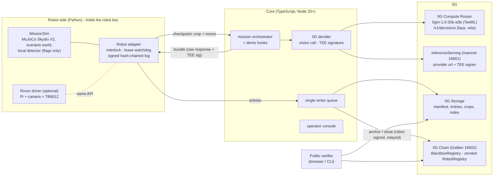

# Blackbox: 0G decides. Blackbox proves it.

**A decision recorder for autonomous inspection robots.** At every checkpoint the robot holds still and sends its camera crop to **0G's own sealed vision model** (`0gm-1.0-35b-a3b`, TeeML on Intel TDX). It moves **only** on an answer signed by an allowlisted 0G TEE signer that echoes its own nonce. Every decision goes into a robot-signed, keccak256-chained episode log on **0G Storage**, and the chain head is anchored on **0G Chain** every 2 decisions. If 0G is unreachable, the robot safe-stops and the log says *"0G unreachable, no decision made"*. It never guesses. Anyone can re-check a mission from one public link, and the mission can be **replayed** from its seed to the same trajectory hash.

**It is a recorder SDK, not a one-off demo.** What the robot inspects, which labels 0G may answer and which actions it may choose live in a *mission profile* (`scenarios/*.json`) that goes into the manifest on 0G Storage. The same code runs a **solar farm O&M survey** and a **bridge-deck crack survey**, flown by a **Skydio X2 quadrotor in MuJoCo** and shown in a 3D operator console.

**Every finding is queryable on Arkiv.** 0G holds the proof; [Arkiv](https://arkiv.network) holds the working data. Each decision becomes an Arkiv entity you can query by panel (`r2m13`), deck square (`x12y03`), label, severity, mission, and the panel's **maker, model and batch** from the site owner's asset register. Every blob uploaded to 0G Storage is mirrored on Arkiv by its root, so the verifier can fall back to it, still checking every hash against 0G Chain. See [Arkiv](#arkiv-queryable-findings-asset-register-backup).

Track: **Physical AI: Agents with a Body** (0G). Lane: robots and machines (MuJoCo drone), plus an optional real rover twin.

**The story in one page:** [docs/narrative.md](docs/narrative.md). **Why 0G, and why a chain:** [docs/why-0g.md](docs/why-0g.md). **Privacy model:** [docs/privacy.md](docs/privacy.md). **Video and booth script:** [docs/demo-script.md](docs/demo-script.md).

> Built on [zerobot](https://github.com/0gfoundation/zerobot): robots are identified by zerobot's `RobotRegistry`, and `BlackboxRegistry` checks `isOperator()` on it.

---

## Contents

1. [What the judges see (demo beats)](#what-the-judges-see)
2. [Qualification map](#qualification-map)
3. [Architecture](#architecture)
4. [SDK: mission profiles and the Robot interface](#sdk-mission-profiles-and-the-robot-interface)
5. [Project structure](#project-structure)
6. [0G technology used](#0g-technology-used) · [Arkiv](#arkiv-queryable-findings-asset-register-backup)
7. [Quick start: offline, no keys](#quick-start-offline-no-keys)
8. [Run on 0G testnet (Galileo)](#run-on-0g-testnet-galileo)
9. [Manual values checklist](#manual-values-checklist)
10. [Going to mainnet](#going-to-mainnet)
11. [Not yet verified against live 0G](#not-yet-verified-against-live-0g)
12. [Testing](#testing)
13. [Claims we make (and don't)](#claims-we-make-and-dont)
14. [Submission checklist](#submission-checklist)
15. [Deployment addresses](#deployment-addresses)
16. [Credits](#credits)

---

## What the judges see

`http://127.0.0.1:8787` opens the **launch page**: a keynote-style product page (Launch Showcase design system) whose hero replays the last mission on the machine in 3D, with live numbers from that mission and a receipt that verifies it. **Try the live demo** opens the operator console at `/console.html`.

The operator console is a full-screen 3D view of the mission: the scenario's world, the MuJoCo drone, its flown path and one pin per checkpoint showing what 0G decided. Hovering the field outlines the asset under the cursor (a PV module, or a 1 m deck square) with its label (`r2m13` = row 2, module 13; `x12y03` = the 1 m² deck square at 12 m, 3 m). The left panel is the whole demo in three steps: **Mark the site → Fly the survey → Prove it**, with a live card for each checkpoint (robot holds → sealed call → 0G answer → interlock → robot acts). The right panel lists the findings by asset; with Arkiv on, **History** shows every inspection of that asset and **Analytics** shows the site across missions, both queried live from Arkiv. The attacks and the kill switch sit in a bottom bar, **Try to break it**. Pick the scenario in the top bar. The flow per scenario is in [docs/demo-script.md](docs/demo-script.md).

| Beat | Judge does | What it shows | Console control |
|---|---|---|---|
| **1. Drop a defect** | Clicks the surface to place defects and benign marks (solar: *Cracked cell* / *Soiling*; deck: *Crack* / *Decoy*), before or during flight | The local detector flags **both**. 0G's sealed call flags the defect and rejects the benign mark. The drone descends only on the defect. The pin and card show `request_id`, TEE signer ✔, binding, and the 0G Storage root | kind buttons, *Start mission* |
| **2. Split screen** | Watches | Same seed, same world, 0G's answers forced to "continue": a second, red drone flies past the defect. **0G's answer moved the robot** | *Replay, 0G forced to "continue"* |
| **3a. Forged decision** | Sends a forged "continue" from the operator console | The robot refuses: *"unsigned decision rejected: signer 0x… is not on the manifest allowlist"*. The refusal is logged | *Forge "continue"* |
| **3b. Tampered answer** | The core flips 0G's real answer but keeps 0G's real signature | The robot refuses: *"TEE signature does not cover this answer"*, asks 0G again, then acts on the genuine answer | *Tamper answer* |
| **3c. Tampered log** | Lowers a severity in a local copy of the log | The verifier turns red and names the entry (*"Entry #2 (decision) was changed after the robot signed it"*) | *Edit log* |
| **4. Kill switch** | Cuts the 0G link mid-mission (or kills the core) | The lease expires, the drone returns home, and the log reads *"0G unreachable, no decision made"*. There is no cached or local stand-in | *Cut 0G link*, *E-stop* |
| **4b. Resume** | Restores 0G after the kill switch and presses *Resume from the stop point* | A new mission takes off with the same seed and marks, flies back to the waypoint where the drone stopped (signed into the parent's last entry), and asks 0G again only about the undecided mark. The verifier checks the parent is closed on 0G Chain at the head the new manifest names | *Restore 0G*, *Resume* |
| **5. Verify on your phone** | Scans the QR | The public verifier reads 0G Chain and 0G Storage **in the browser**: robot signatures, TEE signer, nonces, anchors, manifest, replay | *Verify on 0G*, *Public ↗*, *QR* |

---

## Qualification map

| 0G requirement | How Blackbox meets it | Where in the code |
|---|---|---|
| A 0G call inside the decision loop | At every checkpoint the robot holds, and `0gm-1.0-35b-a3b` (sealed, `X-0G-Provider-Trust-Mode: private`, `verify_tee: true`) classifies the crop and picks `descend`/`continue`. The path depends on the answer (beat 2). Optional **decision model** (`laya`/`vela-2.0-9b` on `/v1/decisions`) gives a calibrated hold | `core/src/zg/decide.ts`, `robot/blackbox_robot/mission.py` |
| Episode log on 0G Storage with a request id per decision | One canonical-JSON entry per event, uploaded with `MemData` via the turbo indexer. Each decision carries `x_0g_trace.request_id`, the chat id (`ZG-Res-Key`), provider, model, the raw response and the TEE signature, chained by keccak256 and signed by the robot key | `robot/blackbox_robot/episode_log.py`, `core/src/storage/index.ts`, `core/src/mission.ts` |
| Replayable simulation | MuJoCo flies the Skydio X2 quadrotor (MuJoCo Menagerie) on four rotor thrusts at 240 Hz, and is re-run from the manifest seed plus the logged answers. Camera crops are re-rendered and compared by pixel hash, and the trajectory hash must match the one on chain | `robot/blackbox_robot/replay.py` |
| Safe stop if 0G is unreachable, never a faked decision | A lease watchdog in the robot adapter (3× median latency, capped at 12 s). Refused answers never extend the lease. The entry reads "0G unreachable, no decision made" | `robot/blackbox_robot/adapter.py` (`_watchdog`) |
| Not a chatbot / no pre-recorded motion / not just logs | No chat UI, and the model only sees frames and returns strict JSON. Motion is recomputed physics. The robot **refuses to act** without 0G's signature | `robot/blackbox_robot/interlock.py` |
| Contract addresses | `BlackboxRegistry` on Galileo (16602), plus zerobot's `RobotRegistry` it reads | [Deployment addresses](#deployment-addresses) |

---

## Architecture



**One checkpoint:**

```mermaid
sequenceDiagram
  participant S as Sim / rover
  participant A as Robot adapter
  participant C as Core
  participant R as 0G Router (TeeML)
  participant P as Provider broker (TEE)
  S->>A: detector flags a patch, robot HOLDS
  A->>A: nonce = keccak256(missionId, obs_hash, k), lease starts
  A->>C: POST /api/checkpoint {crop, nonce}
  C->>R: chat/completions, trust-mode private, verify_tee
  R-->>C: answer JSON + x_0g_trace.request_id + ZG-Res-Key
  C->>P: GET /v1/proxy/signature/{chatID}
  P-->>C: {text: "sha256(req):sha256(resp)", signature}
  C-->>A: bundle (exact response bytes + signature)
  A->>A: interlock: parses? nonce echoed? signer allowlisted? signature covers these bytes?
  alt all pass
    A->>S: actuate (descend / continue)
  else any fails
    A->>A: log "rejected", the lease keeps running
  end
  Note over A: lease expires with no valid answer: SAFE STOP, "0G unreachable, no decision made"
  A->>C: robot-signed log entry (motion never waits)
  C->>C: upload to 0G Storage; every 2 decisions: index + anchor on 0G Chain
```

**Why the robot can check what the core sends.** 0G's serving broker signs `sha256(request):sha256(response bytes)` with EIP-191 (from `0g-serving-broker` `ctrl/signing.go`). The core hands the robot the **exact** Router response bytes. The robot parses the answer from those bytes itself, rebuilds the bytes the broker signed, and checks the hash. A dishonest core cannot pair a real signature with a different answer (beat 3b), and cannot sign one itself (beat 3a).

---

## SDK: mission profiles and the Robot interface

Blackbox is the recorder; the drone is one robot that plugs into it. Two things make it general.

**A mission profile** (`scenarios/<id>.json`) is the task pack. The core validates it (`core/src/profile.ts`) and copies it into the manifest, so it is uploaded to 0G Storage and fixed by the manifest root registered on 0G Chain before takeoff. The robot loads its policy from that manifest:

| Field | Used by | Effect |
|---|---|---|
| `world` | robot (`sdk.make_world`) | Which world the camera reads: `concrete-deck` or `solar-farm` (rows, module size) |
| `sim` | robot (`MissionSim`) | Field size, survey lanes, altitudes, detector threshold, crop size |
| `decision.labels`, `decision.actions`, `decision.severity_max` | both interlocks, the verifier | The only answers 0G may give. Anything else is refused, never mapped to a default |
| `decision.prompt` | core (`ZgDecider`) | The system prompt sent to the sealed model. It must contain the answer template for those labels and actions |
| `decision.label_actions` | mock 0G, demo hooks | Which action each label implies (the forge and tamper beats use it) |
| `ui` | console | Label names and colours |

Adding a scenario is adding a JSON file. A profile may only grant actions the robot has: the adapter refuses a manifest whose actions the robot cannot perform (`sdk.check_policy_fits`).

**The Robot interface** (`robot/blackbox_robot/sdk.py`) is the only way the adapter touches a robot:

```python
from blackbox_robot.sdk import Robot

class MyRobot(Robot):
    ACTIONS = ("descend", "continue")      # what 0G may choose between

    def start(self): ...
    def step(self):                          # one control tick of your own loop
        ...                                  # return {"type": "checkpoint", "png": ..., "nonce": ..., ...}
                                             # when the robot holds for a decision
    def resolve(self, action): ...           # only an interlock-approved action, or "safe_stop"
    def emergency_stop(self): ...
    def state(self): ...
    def trajectory_hash(self): ...
```

`MissionSim` (the MuJoCo drone) and `RoverMission` (the Raspberry Pi rover) both implement it. Worlds register in `sdk.WORLDS`; `solar_world.py` is an example of a new one.

---

## Project structure

```
.
├── README.md                    you are here
├── .env.example                 every setting; values you must fill are marked  <-- SET ME
├── package.json                 root scripts: setup, dev:local, test, robot, core, verify, probe, replay
├── scripts/dev-local.sh         one command: anvil + contracts + mock 0G + core + robot (offline)
├── scenarios/                   mission profiles: solar-farm.json, bridge-deck.json (incl. the asset register)
├── docs/                        why-0g.md (the narrative), demo-script.md (video and booth)
│
├── contracts/                   Foundry, solc 0.8.27, evm cancun
│   ├── src/BlackboxRegistry.sol      register / anchor / close missions; robot-signed (EIP-191), relayable; zerobot isOperator()
│   ├── src/SimpleRobotRegistry.sol   zerobot-compatible stand-in for anvil / mainnet (zerobot is Galileo-only today)
│   ├── src/interfaces/IRobotRegistry.sol  zerobot RobotRegistry subset (struct copied verbatim)
│   ├── script/Deploy.s.sol           deploys, writes deployments/<chainId>.json
│   └── test/BlackboxRegistry.t.sol   10 tests: happy path, forged signer, replayed digest, stale count, revoked operator…
│
├── robot/                       Python 3.9+ (3.11 recommended); the only process with the robot key
│   ├── blackbox_robot/
│   │   ├── sdk.py               Robot interface, world registry, profile vocabulary checks, 3D texture
│   │   ├── world.py             seeded concrete deck, 5 crack + 2 decoy variants, camera crops, anomaly map
│   │   ├── solar_world.py       solar farm: PV module rows, 3 cracked-cell + 2 soiling variants
│   │   ├── mujoco_drone.py      Skydio X2 quadrotor: SE(3) attitude control, rotor mixing
│   │   ├── models/skydio_x2/    MJCF model and mesh from MuJoCo Menagerie (Apache-2.0)
│   │   ├── physics.py           backends: mujoco (default), pybullet, dependency-free "native"
│   │   ├── mission.py           deterministic lawnmower survey, checkpoints, outcomes, trajectory hash
│   │   ├── interlock.py         verify before actuate (parse, nonce, TEE signer, signature binding)
│   │   ├── episode_log.py       canonical JSON + keccak256 chain + robot EIP-191 signatures
│   │   ├── adapter.py           HTTP service: lease watchdog, safe stop, outbox, anchor signing
│   │   ├── replay.py            replay CLI + counterfactual ("force continue")
│   │   ├── rover.py             real-hardware twin (Pi, gpiozero, picamera2), UNTESTED on hardware
│   │   └── probe_images.py      writes the Gate A probe crops
│   ├── assets/probe/            crack-*.png, decoy-*.png used by `npm run probe`
│   └── tests/                   unittest: interlock, adapter flow, lease safe stop, replay; cross-language vectors
│
└── core/                        TypeScript (Node 20+), run with tsx
    ├── src/server.ts            HTTP: console, robot-facing API, demo controls, verifier API
    ├── src/mission.ts           manifest (with the profile), registerMission, checkpoint relay, writer queue, anchors, close, demo hooks
    ├── src/profile.ts           mission profile loader and validation
    ├── src/zg/router.ts         0G Router client (trust mode, failover, kill switch)
    ├── src/zg/services.ts       InferenceServing.getService() reader + /v1/proxy/signature fetch
    ├── src/zg/decide.ts         prompt contract, vision call, bundle, R16 decision model
    ├── src/storage/index.ts     0G Storage (MemData + Indexer) and local dev store
    ├── src/arkiv/               Arkiv: entity schemas, batched writer, browser-safe reads (history, analytics, mirror)
    ├── src/chain/               BlackboxRegistry + RobotRegistry ABIs and client
    ├── src/lib/                 canonical/Go JSON, interlock mirror, serial queue
    ├── src/verifier/            isomorphic verifier (core.ts), CLI, browser bundle entry
    ├── src/mock0g/              DEV-ONLY Router + broker emulator (never a fallback)
    ├── scripts/                 probe-0g.ts (Gate A), setup-robot.ts (zerobot), arkiv-register.ts, arkiv-bench.ts, keys.ts
    ├── test/crosslang.test.ts   Python and TypeScript must agree byte-for-byte
    ├── ui/                      operator console source (React + Tailwind, Vite): `npm run build:console` builds it into web/
    └── web/                     launch page, built console (console.html), 3D scene (scene3d.js), public verifier (verify.html)
                                 vendor/: three.js, qrcode, the X2 mesh (served locally, works offline)
```

---

## 0G technology used

| 0G part | What we use | How | Network | Code |
|---|---|---|---|---|
| **0G Compute, Router** | `POST https://router-api.0g.ai/v1/chat/completions`, OpenAI-compatible, `Authorization: Bearer sk-…` | Header `X-0G-Provider-Trust-Mode: private` (TeeML only), body `verify_tee: true`, image as `image_url` data URI, temperature 0, strict JSON prompt with a nonce echo. Reads `x_0g_trace.request_id`, `.provider`, `.tee_verified` and the `ZG-Res-Key` header | mainnet (providers on 16661) | `core/src/zg/router.ts`, `decide.ts` |
| **Sealed vision model** | `0gm-1.0-35b-a3b` (0G's own model; TeeML, Intel TDX, dstack) | The only vision model listed as TeeML on the Router (checked Nov 4, 2026). Fallback is `qwen3-vl-plus` (TeeTLS; claims then say "route-attested") | mainnet | `ZG_VISION_MODEL` |
| **TEE signature** | `GET {provider url}/v1/proxy/signature/{chatID}` | EIP-191 over `sha256(req):sha256(resp)`. Signer = `teeSignerAddress` (or `TargetTeeAddress` when separated), read from **InferenceServing `getService()` at `0x47340d900bdFec2BD393c626E12ea0656F938d84` on 0G mainnet**, the same rule as the SDK's `processResponse()` | mainnet | `core/src/zg/services.ts` |
| **Decision models** (R16) | `POST /v1/decisions` with `laya` (free) or `vela-2.0-9b` | `noul` question → calibrated probability. Below `DECISION_HOLD_BELOW` the robot holds and asks a human | mainnet | `core/src/zg/decide.ts` |
| **0G Storage** | `@0gfoundation/0g-storage-ts-sdk@1.2.13` (`Indexer`, `MemData`, `upload`, `downloadToBlob`) | Turbo indexer `https://indexer-storage-testnet-turbo.0g.ai`. Uploads the manifest, every log entry, every crop and an index per anchor. The browser verifier reads via the indexer's `GET /file?root=` gateway (CORS `*`) | Galileo | `core/src/storage/index.ts` |
| **0G Chain** | Galileo testnet, chain **16602**, RPC `https://evmrpc-testnet.0g.ai`, explorer `chainscan-galileo.0g.ai` | `BlackboxRegistry`: `registerMission` → `anchor` every 2 decisions → `closeMission(trajectoryHash)`. Robot-signed digests, relayed by the operator wallet | Galileo | `contracts/` |
| **zerobot** | `RobotRegistry` proxy `0x291162e93D7A80Eb8F738882a28a7a8A5FBA73bb` on Galileo | The robot key must be `isOperator(robotId, robot)`. Removing it in zerobot revokes anchoring. `npm run setup:robot` calls `registerRobot` + `addOperator` | Galileo | `core/scripts/setup-robot.ts` |

---

## Arkiv: queryable findings, asset register, backup

0G Storage returns a file by its root and nothing else. Nobody at a solar farm asks for a root: they ask for module r2m13's history, which modules are still cracked, or whether cracked cells cluster in one maker's batch (a warranty claim). Blackbox writes four Arkiv entity types (Rabdi testnet, chain `7794095`); full schema in [arkiv/schema.md](arkiv/schema.md):

| Entity | Written by | Used for |
|---|---|---|
| `blackbox.finding` | the inspector, per decision | per-asset history, analytics; carries maker/model/batch, the entry hash and the 0G Storage root |
| `blackbox.asset` | the **site owner's** wallet (`npm run arkiv:register`) | the register: maker, model, batch, warranty for 136 modules or 192 deck squares (fictional makers) |
| `blackbox.blob` | the inspector, per 0G upload | the backup: every manifest, entry and index by its 0G root |
| `blackbox.mission` | the inspector, at takeoff and close | the fleet board |

**Arkiv is never trusted for the verdict.** When 0G Storage cannot serve a root, the verifier (CLI, core and browser) reads the Arkiv mirror and runs every hash check on those bytes against the anchors on 0G Chain; the report says how many blobs came from the mirror. Arkiv entities expire (90 days by default, Rabdi max ~91): the working set stays bounded, the proof on 0G stays forever.

**Setup.** Fund the inspector wallet (your `OPERATOR_PRIVATE_KEY` address by default) at https://hub.arkiv.network/faucet, then in `.env`:

```bash
ARKIV=rabdi
ARKIV_ACCESS_KEY=...   # optional, free at hub.arkiv.network/access-keys; the public endpoint is rate limited
```

```bash
npm run arkiv:register      # publishes the asset register from a site-owner wallet (made and funded for you if unset)
npm run arkiv:bench         # 0G Storage vs Arkiv on the same log entries -> arkiv/benchmark.md
```

**Run a query yourself** (no key, no SDK):

```bash
curl -s https://rpc.rabdi.db-chain.testnet.arkiv.network -H 'content-type: application/json' \
  -d "{\"jsonrpc\":\"2.0\",\"id\":1,\"method\":\"arkiv_query\",\"params\":[\"arkiv.schema = str('blackbox.finding') AND site = str('solar-farm')\"]}"
```

Wallets that wrote entities: inspector (findings, mirror, missions) [`0xe0a865190ef3e4a4fD2850D5A879B5C224873286`](https://rabdi.explorer.arkiv.network/address/0xe0a865190ef3e4a4fD2850D5A879B5C224873286), site owner (asset register, 136 modules + 192 deck squares) [`0x6DD5505E1FcC2CBA5aA57D7Ae60881B12643128C`](https://rabdi.explorer.arkiv.network/address/0x6DD5505E1FcC2CBA5aA57D7Ae60881B12643128C). Measured against 0G Storage on the same entries: [arkiv/benchmark.md](arkiv/benchmark.md) (Arkiv batch write 7 s vs 76 s, read 0.36 s vs 2.8 s; 0G Storage is permanent, Arkiv expires). Explorer: https://rabdi.explorer.arkiv.network. Why Arkiv, measured costs, friction and plans: [arkiv/](arkiv/).

---

## Quick start: offline, no keys

Needs Node ≥ 20, Python ≥ 3.9 and [Foundry](https://book.getfoundry.sh/getting-started/installation).

```bash
npm run setup
```

```bash
npm run dev:local
```

Open **http://127.0.0.1:8787** (launch page) and **/console.html** (operator console). This runs anvil, deploys the contracts, registers the robot on a zerobot-compatible registry, and starts a **mock 0G** (a yellow banner says so), the core and the robot. The mock signs exactly like the real broker (`sha256(req):sha256(resp)`, EIP-191) with a local key that is **not** a 0G signer. It exists for development and CI only and is never a fallback.

Physics defaults to MuJoCo (prebuilt wheels for Linux, macOS and Windows; CPU only, no GPU needed). PyBullet is optional and compiles from source on macOS arm64 (about 5 minutes); if it fails, remove it from `robot/requirements.txt`. The 3D console falls back to software rendering on machines without a GPU.

---

## Run on 0G testnet (Galileo)

Each step marked **MANUAL** needs you.

**1. Wallets (MANUAL).**

```bash
cp .env.example .env
```

```bash
npm run keys
```

Put `OPERATOR_PRIVATE_KEY` and `ROBOT_PRIVATE_KEY` in `.env`, then fund the **operator** address at https://faucet.0g.ai (0.1 0G/day; Storage fees and gas). The robot key needs no funds: its anchors are relayed.

**2. 0G Router key (MANUAL).** Create an `sk-…` key at https://pc.0g.ai, make a small **mainnet** deposit, and set `ZG_API_KEY`. The Router and its TEE providers are on mainnet even while Storage and Chain are on Galileo.

**3. Deploy `BlackboxRegistry` to Galileo (MANUAL).**

```bash
cd contracts && DEPLOYER_PRIVATE_KEY=<key> ROBOT_REGISTRY=0x291162e93D7A80Eb8F738882a28a7a8A5FBA73bb forge script script/Deploy.s.sol --rpc-url galileo --broadcast
```

Copy `blackboxRegistry` from `contracts/deployments/16602.json` into `.env` as `BLACKBOX_REGISTRY`. If the tx is rejected over fees, add `--legacy --with-gas-price 3000000000`.

Then verify it on chainscan (etherscan-compatible API; confirm the flags against the 0G docs):

```bash
forge verify-contract <BLACKBOX_REGISTRY> src/BlackboxRegistry.sol:BlackboxRegistry --chain-id 16602 --verifier etherscan --verifier-url https://chainscan-galileo.0g.ai/open/api --etherscan-api-key <key> --constructor-args $(cast abi-encode "constructor(address)" 0x291162e93D7A80Eb8F738882a28a7a8A5FBA73bb)
```

**4. Register the robot on zerobot.**

```bash
npm run setup:robot
```

This calls `registerRobot` and `addOperator(robot key)`. Copy the printed `ROBOT_ID=` into `.env`.

**5. Gate A probe against live 0G (MANUAL check).**

```bash
npm run probe -- --echo 20 --storage
```

Then run it for the solar farm profile too, which sends that profile's prompt with the crops in `robot/assets/probe-solar` (regenerate them with `cd robot && .venv/bin/python -m blackbox_robot.probe_images assets/probe-solar solar-farm`):

```bash
npm run probe -- --scenario solar-farm
```

It prints, for each probe crop: label accuracy, nonce echo, TEE signer, **which signature binding matched**, latency and a 1 KB storage round trip. Then:

- set `LEASE_MS` to the printed value (3× the median latency, capped at 12 s);
- set `TEE_BINDING` to the binding that matched (`go` or `raw`). If **none** matched, read [Not yet verified](#not-yet-verified-against-live-0g) before the demo;
- if fewer than 4 of 5 cracks are flagged, or a decoy is not rejected, add real crack photos (`BLACKBOX_TEXTURE_DIR`), and keep `qwen3-vl-plus` as the fallback.

**6. Run.** Use three terminals.

```bash
npm run core
```

```bash
npm run robot
```

Open http://127.0.0.1:8787/console.html, pick a scenario, place a defect and a benign mark, and press **Start mission**. Ledger rows link to storagescan and chainscan.

**7. Public verifier on Vercel (MANUAL).**

```bash
npm --prefix core run build:web && cd core/web && npx vercel deploy --prod
```

`vercel.json` serves `verify.html` at `/`. Set `PUBLIC_VERIFIER_URL=https://<your-app>.vercel.app/verify.html` so the console's QR code works on a phone. The page needs no backend: it reads Galileo RPC plus the indexer gateway directly.

**8. Command-line verify and replay.**

```bash
npm run verify -- --mission 0x<missionId>
```

```bash
npm run replay -- --core http://127.0.0.1:8787 --mission 0x<missionId>
```

---

## Manual values checklist

| Value | Where | How to get it | Needed for |
|---|---|---|---|
| `OPERATOR_PRIVATE_KEY` | `.env` | `npm run keys`, then fund at faucet.0g.ai | Storage fees, registry txs, zerobot robot owner |
| `ROBOT_PRIVATE_KEY` | `.env` (robot machine only) | `npm run keys` | robot signatures (no funds) |
| `DEPLOYER_PRIVATE_KEY` | shell / `.env` | can equal the operator key | `forge script` |
| `ZG_API_KEY` | `.env` | pc.0g.ai → API keys (`sk-…`) + mainnet deposit | every 0G Compute call |
| `BLACKBOX_REGISTRY` | `.env` + [addresses table](#deployment-addresses) | step 3 | chain anchoring, verifier |
| `ROBOT_ID` | `.env` | step 4 | registerMission |
| `LEASE_MS`, `TEE_BINDING` | `.env` | step 5 (`npm run probe`) | safe-stop lease, interlock |
| `ZG_ROUTER_ENDPOINTS` 2nd entry | `.env` | **testnet Router URL: not documented; ask at the 0G booth** | R17 failover |
| `PUBLIC_VERIFIER_URL` | `.env` | step 7 | QR code |
| `ARKIV=rabdi`, tGLM on the inspector wallet | `.env` | https://hub.arkiv.network/faucet, then `npm run arkiv:register` | queryable findings, analytics, the 0G Storage mirror |
| `CHAINSCAN_API_KEY` | shell | chainscan account | contract verification |
| Real crack textures | `BLACKBOX_TEXTURE_DIR/crack/*.png`, `/decoy/*.png` | e.g. a CC-BY concrete-crack dataset (credit it below) | Gate A accuracy on 0GM |
| Rover pins | `ROVER_*` env (see `robot/blackbox_robot/rover.py`) | your wiring | hardware lane |

---

## Going to mainnet

Everything is config. Nothing in the code is testnet-specific.

1. `CHAIN=mainnet` (chain 16661). Storage switches to `https://indexer-storage-turbo.0g.ai` (set `STORAGE_NETWORK=mainnet`).
2. **Robot identity:** zerobot is not deployed on mainnet yet. Either deploy zerobot's own contracts (Hardhat scripts in their repo, Apache-2.0), or let `Deploy.s.sol` deploy our ABI-compatible `SimpleRobotRegistry` by leaving `ROBOT_REGISTRY` unset:

   ```bash
   cd contracts && DEPLOYER_PRIVATE_KEY=<key> forge script script/Deploy.s.sol --rpc-url mainnet --broadcast
   ```

3. Set `RPC_URL` to a third-party RPC; the 0G docs call `evmrpc` development-only.
4. Use a dedicated operator wallet with real 0G for Storage fees and gas. Keep `ROBOT_PRIVATE_KEY` only on the robot, ideally in a secure element or HSM.
5. Redeploy the verifier with `?network=mainnet&registry=<mainnet registry>`.
6. Compute is unchanged: the Router and the TEE signer lookup are already mainnet.

---

## Unsealed fallback (only when no TEE vision provider is healthy)

`0gm-1.0-35b-a3b` is the only TEE vision model on the Router, and it has one provider. When `GET /v1/providers` reports that provider `is_healthy: false`, a Private key cannot reach any image-capable model. Setting `ZG_ATTESTATION=none` (with a Standard-trust key, `ZG_TRUST_MODE=standard` and another vision model such as `qwen3-vl-plus`) lets the demo still run on 0G's Router, Storage and Chain.

It is explicit everywhere, never a silent downgrade:

- The manifest records `policy.attestation = "none"`, so it is anchored with the mission.
- The robot still parses and nonce-checks every answer, but prints a warning at takeoff and skips the TEE signature, signer and binding checks.
- The console badge reads *unsealed, not TEE-attested*, and the verifier shows `WARN` (not `PASS`) on the signer, binding and registry checks, with the reason.
- The default is `ZG_ATTESTATION=tee`. The sealed claims in this README hold only for `tee` runs.

## Not yet verified against live 0G

These were researched from the 0G docs and SDK source but **not exercised with a real `sk-` key** while building. The probe (step 5) checks all of them.

| Assumption | Why it matters | Fallback |
|---|---|---|
| **Signature binding through the Router.** The broker signs `sha256(upstream request):sha256(response bytes)`. The Router adds `x_0g_trace`; we assume it re-marshals Go-style, so removing `x_0g_*` and re-marshalling rebuilds the signed bytes (`go`). `raw` covers pass-through | If neither matches, the robot (correctly) refuses every answer and safe-stops | Call the provider directly (Direct mode via `@0gfoundation/0g-compute-ts-sdk` `getRequestHeaders`), where the response bytes are the signed bytes |
| `0gm-1.0-35b-a3b` accepts an OpenAI `image_url` data URI | The vision call | Try the `anthropic` message format (both are listed as supported) |
| The Router passes `ZG-Res-Key`; otherwise the body id is `chatcmpl-<chatKey>` | Signature lookup | We try header, then stripped body id, then the raw body id |
| Signatures are kept about 20 minutes, in memory, on the broker | The verifier needs them later | We fetch right after each answer and store `{text, signature}` in the entry |
| `/v1/decisions` response schema is undocumented | R16 hold | The parser searches for a probability. If none is found it never holds and records the raw response |
| Testnet Router URL for R17 failover | Second endpoint | Ask at the booth. Failover code is ready (`ZG_ROUTER_ENDPOINTS`) |
| Indexer `GET /file?root=` returns raw bytes for existing files (it returned `{"code":101}` for unknown roots) | Browser verifier | Point the verifier's *Storage source* at a public core (`/api/storage/:root`, SDK download) |
| storagescan URL format `/tx/<hash>` | Links only | Cosmetic |

---

## Testing

```bash
npm test
```

This runs:

- **contracts**: 10 Foundry tests (register/anchor/close; non-operator signer; replayed digest; stale count; revoked zerobot operator; closed mission).
- **robot**: unittests (28 plus 3 asset-naming tests). The interlock refuses forged, tampered, unsigned and wrong-nonce answers and answers with extra keys. A full adapter mission covers forgery refusals, a replay match and a tampered entry named. The lease safe-stops with "0G unreachable, no decision made". SDK tests: the profile's vocabulary is enforced both ways, a profile cannot grant actions the robot lacks, the world registry, and a MuJoCo solar survey that is deterministic and flies by tilting.
- **core**: type-check plus 7 cross-language tests. Python and TypeScript agree byte-for-byte on canonical JSON, Go-style JSON, nonces, interlock verdicts, entry hashes and robot signatures, and the mock classifier separates all 7 probe crops. The mock also judges PV-module crops (cracked cells vs soiling) and answers in whatever vocabulary the profile's prompt declares. `test/arkiv.test.ts`: every asset label maps to one register entry, and blobs served by the Arkiv mirror are reported, never hidden. `test/privacy.test.ts`: crops round-trip under the mission key and fail under any other.

End to end (local): `npm run dev:local`, then drive the console. All beats above were run against the local stack while building.

---

## Claims we make (and don't)

| Say | Don't say |
|---|---|
| "The robot only acts on answers signed by an allowlisted 0G TEE signer." | "0G controls the robot." |
| "Each answer echoes the robot's nonce, so it was produced fresh for this request." | "The answer is about this exact frame." (The core could still send a different image; the crop and its hash are logged for audit.) |
| "Sealed inference on 0GM-1.0." (only when R1 runs on `0gm-1.0-35b-a3b`) | "Sealed" with the Qwen fallback; say "route-attested" instead |
| "Tamper-evident log." | "Tamper-proof." / "Proves what the camera saw." |

Our nonce is `keccak256(missionId, obs_hash, checkpoint)`. That is the PRD's `keccak256(obs_hash, seq)` plus the mission id, so an answer signed in one mission cannot be replayed in another.

---

## Submission checklist

- [ ] Project name and short description (top of this README)
- [ ] Public GitHub repo with README and setup instructions
- [ ] Demo video under 3 minutes (2:30 to 2:50, beats above) and the live demo link (Vercel verifier)
- [ ] Contract deployment addresses (table below) with chainscan links
- [ ] 3 sample `request_id`s with storagescan links (`npm run verify` prints them)
- [ ] Team names and contacts (Telegram, X)

## Deployment addresses

| Contract | Network | Address |
|---|---|---|
| `BlackboxRegistry` | 0G Galileo (16602) | [`0x8d2793615Cb9953c451eecc065a23FfAaBA777a3`](https://chainscan-galileo.0g.ai/address/0x8d2793615Cb9953c451eecc065a23FfAaBA777a3) |
| zerobot `RobotRegistry` (read) | 0G Galileo (16602) | [`0x291162e93D7A80Eb8F738882a28a7a8A5FBA73bb`](https://chainscan-galileo.0g.ai/address/0x291162e93D7A80Eb8F738882a28a7a8A5FBA73bb) |
| 0G Compute `InferenceServing` (read) | 0G mainnet (16661) | [`0x47340d900bdFec2BD393c626E12ea0656F938d84`](https://chainscan.0g.ai/address/0x47340d900bdFec2BD393c626E12ea0656F938d84) |
| `BlackboxRegistry` | 0G mainnet (16661) | `TODO after the hackathon` |
| Arkiv (Rabdi testnet, 7794095) | entities `blackbox.finding/asset/blob/mission` | writers `0xe0a865190ef3e4a4fD2850D5A879B5C224873286` (inspector), `0x6DD5505E1FcC2CBA5aA57D7Ae60881B12643128C` (site owner) |

Sample mission, flown live on Galileo with the **unsealed** fallback model `qwen3-vl-plus` (the sealed `0gm-1.0-35b-a3b` provider was unhealthy that day, so the verifier shows `WARN` on the signer and binding checks). Mission `0x9342ca73…1e31a`, 2 defects placed (one crack, one decoy), replay matched trajectory `0x358a0184…d60e`.

| Entry | 0G answer | request_id | entry root (0G Storage) | storagescan |
|---|---|---|---|---|
| #1 | crack, severity 2 → descend | `13bc0519-616a-49eb-8dc2-e66169b366bd` | `0x005f87c6…cdda` | [tx](https://storagescan-galileo.0g.ai/tx/0x5b2763a1566afc2f747334618bbfecf0f8d80988e945238efdbeabbb8acc61f3) |
| #2 | decoy, severity 0 → continue | `5ee39450-b51d-4310-9f91-ce01537066f2` | `0xe7f10b68…5e7f` | [tx](https://storagescan-galileo.0g.ai/tx/0x9435c4875ded28c38c1efacf7c2fb67a33bdf0ddab0f58065c9ea1cd3ccc1170) |

On 0G Chain (Galileo): [`registerMission`](https://chainscan-galileo.0g.ai/tx/0x7a22b8423a34a4057146a25dae5d67b7396eb587fc544245d217bb1ed917af79), [anchor at 3 entries](https://chainscan-galileo.0g.ai/tx/0x05a1ee38bb04e6af54bb97a91a134d3489fce0d1517ef9feef46166427ca4c6e), [anchor and close at 4 entries](https://chainscan-galileo.0g.ai/tx/0x54dae5821bce772e01852038348effb9966ebd3f9dafce326867ab968a675ff4).

---

## Credits

- [zerobot](https://github.com/0gfoundation/zerobot) (Apache-2.0): robot identity; the `IRobotRegistry` struct layout is copied from it.
- [MuJoCo](https://mujoco.org) (Apache-2.0): physics. The [Skydio X2 model](https://github.com/google-deepmind/mujoco_menagerie/tree/main/skydio_x2) from MuJoCo Menagerie (Apache-2.0, assets provided by Skydio) is vendored in `robot/blackbox_robot/models/skydio_x2/` with its licence.
- [PyBullet](https://pybullet.org) (zlib): optional physics backend.
- [three.js](https://threejs.org) r170 (MIT) and [qrcode-generator](https://github.com/kazuhikoarase/qrcode-generator) (MIT), vendored in `core/web/vendor/` with their licences.
- 0G Compute, Storage and Chain docs and SDKs: `@0gfoundation/0g-storage-ts-sdk`, `@0gfoundation/0g-compute-ts-sdk` (constants and the `processResponse` logic referenced), `0g-serving-broker` (signed-text format).
- Crack, decoy, PV-module, cracked-cell and soiling textures are procedural (`robot/blackbox_robot/world.py`, `solar_world.py`). If you add real photos, credit their dataset and licence here.
