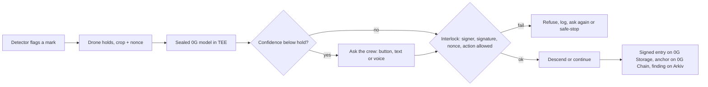
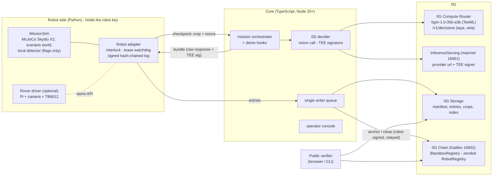

# Blackbox: 0G decides. Blackbox proves it.

**A decision recorder for autonomous inspection robots.** At every checkpoint the robot holds still and sends its camera crop to **0G's own sealed vision model** (`0gm-1.0-35b-a3b`, TeeML on Intel TDX). It moves **only** on an answer signed by an allowlisted 0G TEE signer that echoes its own nonce. Every decision goes into a robot-signed, keccak256-chained episode log on **0G Storage**, and the chain head is anchored on **0G Chain** every 2 decisions. If 0G is unreachable, the robot safe-stops and the log says *"0G unreachable, no decision made"*. It never guesses. Anyone can re-check a mission from one public link, and the mission can be **replayed** from its seed to the same trajectory hash.

**It is a recorder SDK, not a one-off demo.** What the robot inspects, which labels 0G may answer and which actions it may choose live in a *mission profile* (`scenarios/*.json`) that goes into the manifest on 0G Storage. The same code runs a **solar farm O&M survey** and a **bridge-deck crack survey**, flown by a **Skydio X2 quadrotor in MuJoCo** and shown in a 3D operator console.

**Every finding is queryable on Arkiv.** 0G holds the proof; [Arkiv](https://arkiv.network) holds the working data. Each decision becomes an Arkiv entity you can query by panel (`r2m13`), deck square (`x12y03`), label, severity, mission, and the panel's **maker, model and batch** from the site owner's asset register. Every blob uploaded to 0G Storage is mirrored on Arkiv by its root, so the verifier can fall back to it, still checking every hash against 0G Chain. See [Arkiv](#arkiv-queryable-findings-asset-register-backup).

Track: **Physical AI: Agents with a Body** (0G). Lane: robots and machines (MuJoCo drone), plus an optional real rover twin.

**The story in one page:** [docs/narrative.md](docs/narrative.md). **Why 0G, and why a chain:** [docs/why-0g.md](docs/why-0g.md). **Privacy model:** [docs/privacy.md](docs/privacy.md). **Video and booth script:** [docs/demo-script.md](docs/demo-script.md).

> Built on [zerobot](https://github.com/0gfoundation/zerobot): robots are identified by zerobot's `RobotRegistry`, and `BlackboxRegistry` checks `isOperator()` on it.

---

## Contents

1. [What the judges see](#what-the-judges-see)
2. [Qualification map](#qualification-map)
3. [Why web3, why 0G, why Arkiv](#why-web3-why-0g-why-arkiv)
4. [Workflows: vision, text, voice](#workflows-vision-text-voice)
5. [Architecture](#architecture)
6. [SDK: mission profiles and the Robot interface](#sdk-mission-profiles-and-the-robot-interface)
7. [0G technology used](#0g-technology-used)
8. [Arkiv: queryable findings, asset register, backup](#arkiv-queryable-findings-asset-register-backup)
9. [Quick start: offline, no keys](#quick-start-offline-no-keys)
10. [Testing](#testing)
11. [Claims we make (and don't)](#claims-we-make-and-dont)
12. [Deployment addresses](#deployment-addresses)
13. [Credits](#credits)

Also: [project structure](docs/project-structure.md) · [running on 0G testnet and mainnet](docs/running-on-0g.md)

---

## What the judges see

`http://127.0.0.1:8787` opens the **launch page**: a keynote-style product page (Launch Showcase design system) whose hero replays the last mission on the machine in 3D, with live numbers from that mission and a receipt that verifies it. **Try the live demo** opens the operator console at `/console.html`.

The operator console is a full-screen 3D view of the mission: the scenario's world, the MuJoCo drone, its flown path and one pin per checkpoint showing what 0G decided. Hovering the field outlines the asset under the cursor (a PV module, or a 1 m deck square) with its label (`r2m13` = row 2, module 13; `x12y03` = the 1 m² deck square at 12 m, 3 m). The left panel is the whole demo in three steps: **Mark the site → Fly the survey → Prove it**, with a live card for each checkpoint (robot holds → sealed call → 0G answer → interlock → robot acts). The right panel lists the findings by asset; with Arkiv on, **History** shows every inspection of that asset and **Analytics** shows the site across missions, both queried live from Arkiv. The attacks and the kill switch sit in a bottom bar, **Try to break it**. Pick the scenario in the top bar. The flow per scenario is in [docs/demo-script.md](docs/demo-script.md).

| Beat | Judge does | What it shows | Console control |
|---|---|---|---|
| **1. Drop a defect** | Clicks the surface to place defects and benign marks (solar: *Cracked cell* / *Soiling*; deck: *Crack* / *Decoy*), before or during flight | The local detector flags **both**. 0G's sealed call flags the defect and rejects the benign mark. The drone descends only on the defect. The pin and card show `request_id`, TEE signer ✔, binding, and the 0G Storage root | kind buttons, *Start mission* |
| **2. Split screen** | Watches | Same seed, same world, 0G's answers forced to "continue": a second, red drone flies past the defect. **0G's answer moved the robot** | *Replay, 0G forced to "continue"* |
| **3a. Forged decision** | Sends a forged "continue" from the operator console | The robot refuses: *"unsigned decision rejected: signer 0x… is not on the manifest allowlist"*. The refusal is logged | *Forge "continue"* |
| **3b. Tampered answer** | The core flips 0G's real answer but keeps 0G's real signature | The robot refuses: *"TEE signature does not cover this answer"*, asks 0G again, then acts on the genuine answer | *Tamper answer* |
| **3c. Tampered log** | Lowers a severity in a local copy of the log | The verifier turns red and names the entry (*"Entry #2 (decision) was changed after the robot signed it"*) | *Edit log* |
| **4. Kill switch** | Cuts the 0G link mid-mission (or kills the core) | The lease expires, the drone returns home, and the log reads *"0G unreachable, no decision made"*. There is no cached or local stand-in | *Cut 0G link*, *E-stop* |
| **4b. Resume** | Restores 0G after the kill switch and presses *Resume from the stop point* | A new mission takes off with the same seed and marks, flies back to the waypoint where the drone stopped (signed into the parent's last entry), and asks 0G again only about the undecided mark. The verifier checks the parent is closed on 0G Chain at the head the new manifest names | *Restore 0G*, *Resume* |
| **5. Verify on your phone** | Scans the QR | The public verifier reads 0G Chain and 0G Storage **in the browser**: robot signatures, TEE signer, nonces, anchors, manifest, replay | *Verify on 0G*, *Public ↗*, *QR* |

---

## Qualification map

| 0G requirement | How Blackbox meets it | Where in the code |
|---|---|---|
| A 0G call inside the decision loop | At every checkpoint the robot holds, and `0gm-1.0-35b-a3b` (sealed, `X-0G-Provider-Trust-Mode: private`, `verify_tee: true`) classifies the crop and picks `descend`/`continue`. The path depends on the answer (beat 2). Optional **decision model** (`laya`/`vela-2.0-9b` on `/v1/decisions`) gives a calibrated hold | `core/src/zg/decide.ts`, `robot/blackbox_robot/mission.py` |
| Episode log on 0G Storage with a request id per decision | One canonical-JSON entry per event, uploaded with `MemData` via the turbo indexer. Each decision carries `x_0g_trace.request_id`, the chat id (`ZG-Res-Key`), provider, model, the raw response and the TEE signature, chained by keccak256 and signed by the robot key | `robot/blackbox_robot/episode_log.py`, `core/src/storage/index.ts`, `core/src/mission.ts` |
| Replayable simulation | MuJoCo flies the Skydio X2 quadrotor (MuJoCo Menagerie) on four rotor thrusts at 240 Hz, and is re-run from the manifest seed plus the logged answers. Camera crops are re-rendered and compared by pixel hash, and the trajectory hash must match the one on chain | `robot/blackbox_robot/replay.py` |
| Safe stop if 0G is unreachable, never a faked decision | A lease watchdog in the robot adapter (3× median latency, capped at 12 s). Refused answers never extend the lease. The entry reads "0G unreachable, no decision made" | `robot/blackbox_robot/adapter.py` (`_watchdog`) |
| Not a chatbot / no pre-recorded motion / not just logs | No chat UI, and the model only sees frames and returns strict JSON. Motion is recomputed physics. The robot **refuses to act** without 0G's signature | `robot/blackbox_robot/interlock.py` |
| Contract addresses | `BlackboxRegistry` on Galileo (16602), plus zerobot's `RobotRegistry` it reads | [Deployment addresses](#deployment-addresses) |

---

## Why web3, why 0G, why Arkiv

**Why web3.** The owner, the insurer, the panel maker and the contractor don't trust each other, and the party running the drone has the most reason to edit the record. A robot-signed hash chain proves a file wasn't edited. It can't prove which model decided, that the answer was made for this checkpoint, or that the robot did only what it was told. A public chain gives all four parties a timestamped commitment none of them can quietly rewrite, checkable from a phone with no account.

**Why 0G.** Compute, storage and chain in one network, all three inside the control loop: the sealed model decides, 0G Storage holds the signed log, 0G Chain anchors it. No 0G, no decision.

**What it costs.** About 1 panel in 100 is defective on a real survey (2,481 of 232,934 modules, [Remote Sensing 2023](https://www.mdpi.com/2072-4292/15/7/1914)). Blackbox asks 0G only about crops the on-board detector flags (1.5%, measured over 8 sim runs), so sealed inference costs about **$0.0035 per MW**, about $0.35 for 100 MW, against $300 to $500 per MW for a human drone survey. Workings and assumptions: [docs/pitch-numbers-and-workflows.md](docs/pitch-numbers-and-workflows.md).

**Why Arkiv as well.** 0G makes the record provable, not askable: storage returns a file by root and nothing else. Arkiv makes each finding queryable by panel, maker and batch, owned by the wallet that wrote it, expiring after the working period. It is never trusted for the verdict. Full narrative: [docs/narrative-0g-arkiv.md](docs/narrative-0g-arkiv.md).

---

## Workflows: vision, text, voice

Every input ends the same way: the sealed model picks one action from the mission profile, the interlock checks it, and the entry goes into the same hash-chained log. Page: `/workflows.html`.

**1. Vision (built).** The current loop for `solar-farm` and `bridge-deck`.



**2. Text and 3. Voice (built).** When 0G is unsure, the drone holds and the crew answers in words, typed or spoken through the console mic. The same sealed model maps the words to one allowed label and action, the answer must echo a nonce bound to those words, and the robot runs the normal interlock on it. Detail: [docs/voice-workflow.md](docs/voice-workflow.md).

**Try it.** In the console press **Ask the crew** (bottom bar); at the next checkpoint the drone holds and Findings shows a reply box and a mic. Or set `HOLD_ON_UNSURE=1` to hold whenever 0G's vision answer is `unsure`. Real uses: the crew on the ground sees what a crop can't (hail damage, a nest, a hot junction box) and the call becomes part of the evidence; "who told it to descend?" has an answer in the log.


---

## Architecture



**One checkpoint:**

```mermaid
sequenceDiagram
  participant S as Sim / rover
  participant A as Robot adapter
  participant C as Core
  participant R as 0G Router (TeeML)
  participant P as Provider broker (TEE)
  S->>A: detector flags a patch, robot HOLDS
  A->>A: nonce = keccak256(missionId, obs_hash, k), lease starts
  A->>C: POST /api/checkpoint {crop, nonce}
  C->>R: chat/completions, trust-mode private, verify_tee
  R-->>C: answer JSON + x_0g_trace.request_id + ZG-Res-Key
  C->>P: GET /v1/proxy/signature/{chatID}
  P-->>C: {text: "sha256(req):sha256(resp)", signature}
  C-->>A: bundle (exact response bytes + signature)
  A->>A: interlock: parses? nonce echoed? signer allowlisted? signature covers these bytes?
  alt all pass
    A->>S: actuate (descend / continue)
  else any fails
    A->>A: log "rejected", the lease keeps running
  end
  Note over A: lease expires with no valid answer: SAFE STOP, "0G unreachable, no decision made"
  A->>C: robot-signed log entry (motion never waits)
  C->>C: upload to 0G Storage; every 2 decisions: index + anchor on 0G Chain
```

**Why the robot can check what the core sends.** 0G's serving broker signs `sha256(request):sha256(response bytes)` with EIP-191 (from `0g-serving-broker` `ctrl/signing.go`). The core hands the robot the **exact** Router response bytes. The robot parses the answer from those bytes itself, rebuilds the bytes the broker signed, and checks the hash. A dishonest core cannot pair a real signature with a different answer (beat 3b), and cannot sign one itself (beat 3a).

---

## SDK: mission profiles and the Robot interface

Blackbox is the recorder; the drone is one robot that plugs into it. Two things make it general.

**A mission profile** (`scenarios/<id>.json`) is the task pack. The core validates it (`core/src/profile.ts`) and copies it into the manifest, so it is uploaded to 0G Storage and fixed by the manifest root registered on 0G Chain before takeoff. The robot loads its policy from that manifest:

| Field | Used by | Effect |
|---|---|---|
| `world` | robot (`sdk.make_world`) | Which world the camera reads: `concrete-deck` or `solar-farm` (rows, module size) |
| `sim` | robot (`MissionSim`) | Field size, survey lanes, altitudes, detector threshold, crop size |
| `decision.labels`, `decision.actions`, `decision.severity_max` | both interlocks, the verifier | The only answers 0G may give. Anything else is refused, never mapped to a default |
| `decision.prompt` | core (`ZgDecider`) | The system prompt sent to the sealed model. It must contain the answer template for those labels and actions |
| `decision.label_actions` | mock 0G, demo hooks | Which action each label implies (the forge and tamper beats use it) |
| `ui` | console | Label names and colours |

Adding a scenario is adding a JSON file. A profile may only grant actions the robot has: the adapter refuses a manifest whose actions the robot cannot perform (`sdk.check_policy_fits`).

**The Robot interface** (`robot/blackbox_robot/sdk.py`) is the only way the adapter touches a robot:

```python
from blackbox_robot.sdk import Robot

class MyRobot(Robot):
    ACTIONS = ("descend", "continue")      # what 0G may choose between

    def start(self): ...
    def step(self):                          # one control tick of your own loop
        ...                                  # return {"type": "checkpoint", "png": ..., "nonce": ..., ...}
                                             # when the robot holds for a decision
    def resolve(self, action): ...           # only an interlock-approved action, or "safe_stop"
    def emergency_stop(self): ...
    def state(self): ...
    def trajectory_hash(self): ...
```

`MissionSim` (the MuJoCo drone) and `RoverMission` (the Raspberry Pi rover) both implement it. Worlds register in `sdk.WORLDS`; `solar_world.py` is an example of a new one.

---

## 0G technology used

| 0G part | What we use | How | Network | Code |
|---|---|---|---|---|
| **0G Compute, Router** | `POST https://router-api.0g.ai/v1/chat/completions`, OpenAI-compatible, `Authorization: Bearer sk-…` | Header `X-0G-Provider-Trust-Mode: private` (TeeML only), body `verify_tee: true`, image as `image_url` data URI, temperature 0, strict JSON prompt with a nonce echo. Reads `x_0g_trace.request_id`, `.provider`, `.tee_verified` and the `ZG-Res-Key` header | mainnet (providers on 16661) | `core/src/zg/router.ts`, `decide.ts` |
| **Sealed vision model** | `0gm-1.0-35b-a3b` (0G's own model; TeeML, Intel TDX, dstack) | The only vision model listed as TeeML on the Router (checked Nov 4, 2026). Fallback is `qwen3-vl-plus` (TeeTLS; claims then say "route-attested") | mainnet | `ZG_VISION_MODEL` |
| **TEE signature** | `GET {provider url}/v1/proxy/signature/{chatID}` | EIP-191 over `sha256(req):sha256(resp)`. Signer = `teeSignerAddress` (or `TargetTeeAddress` when separated), read from **InferenceServing `getService()` at `0x47340d900bdFec2BD393c626E12ea0656F938d84` on 0G mainnet**, the same rule as the SDK's `processResponse()` | mainnet | `core/src/zg/services.ts` |
| **Decision models** (R16) | `POST /v1/decisions` with `laya` (free) or `vela-2.0-9b` | `noul` question → calibrated probability. Below `DECISION_HOLD_BELOW` the robot holds and asks a human | mainnet | `core/src/zg/decide.ts` |
| **0G Storage** | `@0gfoundation/0g-storage-ts-sdk@1.2.13` (`Indexer`, `MemData`, `upload`, `downloadToBlob`) | Turbo indexer `https://indexer-storage-testnet-turbo.0g.ai`. Uploads the manifest, every log entry, every crop and an index per anchor. The browser verifier reads via the indexer's `GET /file?root=` gateway (CORS `*`) | Galileo | `core/src/storage/index.ts` |
| **0G Chain** | Galileo testnet, chain **16602**, RPC `https://evmrpc-testnet.0g.ai`, explorer `chainscan-galileo.0g.ai` | `BlackboxRegistry`: `registerMission` → `anchor` every 2 decisions → `closeMission(trajectoryHash)`. Robot-signed digests, relayed by the operator wallet | Galileo | `contracts/` |
| **zerobot** | `RobotRegistry` proxy `0x291162e93D7A80Eb8F738882a28a7a8A5FBA73bb` on Galileo | The robot key must be `isOperator(robotId, robot)`. Removing it in zerobot revokes anchoring. `npm run setup:robot` calls `registerRobot` + `addOperator` | Galileo | `core/scripts/setup-robot.ts` |

---

## Arkiv: queryable findings, asset register, backup

0G Storage returns a file by its root and nothing else. Nobody at a solar farm asks for a root: they ask for module r2m13's history, which modules are still cracked, or whether cracked cells cluster in one maker's batch (a warranty claim). Blackbox writes four Arkiv entity types (Rabdi testnet, chain `7794095`); full schema in [arkiv/schema.md](arkiv/schema.md):

| Entity | Written by | Used for |
|---|---|---|
| `blackbox.finding` | the inspector, per decision | per-asset history, analytics; carries maker/model/batch, the entry hash and the 0G Storage root |
| `blackbox.asset` | the **site owner's** wallet (`npm run arkiv:register`) | the register: maker, model, batch, warranty for 136 modules or 192 deck squares (fictional makers) |
| `blackbox.blob` | the inspector, per 0G upload | the backup: every manifest, entry and index by its 0G root |
| `blackbox.mission` | the inspector, at takeoff and close | the fleet board |

**Arkiv is never trusted for the verdict.** When 0G Storage cannot serve a root, the verifier (CLI, core and browser) reads the Arkiv mirror and runs every hash check on those bytes against the anchors on 0G Chain; the report says how many blobs came from the mirror. Arkiv entities expire (90 days by default, Rabdi max ~91): the working set stays bounded, the proof on 0G stays forever.

**Setup.** Fund the inspector wallet (your `OPERATOR_PRIVATE_KEY` address by default) at https://hub.arkiv.network/faucet, then in `.env`:

```bash
ARKIV=rabdi
ARKIV_ACCESS_KEY=...   # optional, free at hub.arkiv.network/access-keys; the public endpoint is rate limited
```

```bash
npm run arkiv:register      # publishes the asset register from a site-owner wallet (made and funded for you if unset)
npm run arkiv:bench         # 0G Storage vs Arkiv on the same log entries -> arkiv/benchmark.md
```

**Run a query yourself** (no key, no SDK):

```bash
curl -s https://rpc.rabdi.db-chain.testnet.arkiv.network -H 'content-type: application/json' \
  -d "{\"jsonrpc\":\"2.0\",\"id\":1,\"method\":\"arkiv_query\",\"params\":[\"arkiv.schema = str('blackbox.finding') AND site = str('solar-farm')\"]}"
```

Wallets that wrote entities: inspector (findings, mirror, missions) [`0xe0a865190ef3e4a4fD2850D5A879B5C224873286`](https://rabdi.explorer.arkiv.network/address/0xe0a865190ef3e4a4fD2850D5A879B5C224873286), site owner (asset register, 136 modules + 192 deck squares) [`0x6DD5505E1FcC2CBA5aA57D7Ae60881B12643128C`](https://rabdi.explorer.arkiv.network/address/0x6DD5505E1FcC2CBA5aA57D7Ae60881B12643128C). Measured against 0G Storage on the same entries: [arkiv/benchmark.md](arkiv/benchmark.md) (Arkiv batch write 7 s vs 76 s, read 0.36 s vs 2.8 s; 0G Storage is permanent, Arkiv expires). Explorer: https://rabdi.explorer.arkiv.network. Why Arkiv, measured costs, friction and plans: [arkiv/](arkiv/).

---

## Quick start: offline, no keys

Needs Node ≥ 20, Python ≥ 3.9 and [Foundry](https://book.getfoundry.sh/getting-started/installation).

```bash
npm run setup
```

```bash
npm run dev:local
```

Open **http://127.0.0.1:8787** (launch page) and **/console.html** (operator console). This runs anvil, deploys the contracts, registers the robot on a zerobot-compatible registry, and starts a **mock 0G** (a yellow banner says so), the core and the robot. The mock signs exactly like the real broker (`sha256(req):sha256(resp)`, EIP-191) with a local key that is **not** a 0G signer. It exists for development and CI only and is never a fallback.

Physics defaults to MuJoCo (prebuilt wheels for Linux, macOS and Windows; CPU only, no GPU needed). PyBullet is optional and compiles from source on macOS arm64 (about 5 minutes); if it fails, remove it from `robot/requirements.txt`. The 3D console falls back to software rendering on machines without a GPU.

**On 0G testnet:** wallets, Router key, contract deploy, probe, mainnet and the open assumptions are in [docs/running-on-0g.md](docs/running-on-0g.md).

---

## Testing

```bash
npm test
```

Runs 10 Foundry contract tests, the Python robot unittests (interlock refusals, adapter flow, lease safe-stop, replay, SDK profile checks) and the TypeScript type-check plus cross-language tests that require Python and TypeScript to agree byte-for-byte on hashes, nonces and signatures. End to end: `npm run dev:local`, then drive the console.

---

## Claims we make (and don't)

| Say | Don't say |
|---|---|
| "The robot only acts on answers signed by an allowlisted 0G TEE signer." | "0G controls the robot." |
| "Each answer echoes the robot's nonce, so it was produced fresh for this request." | "The answer is about this exact frame." (The core could still send a different image; the crop and its hash are logged for audit.) |
| "Sealed inference on 0GM-1.0." (only when R1 runs on `0gm-1.0-35b-a3b`) | "Sealed" with the Qwen fallback; say "route-attested" instead |
| "Tamper-evident log." | "Tamper-proof." / "Proves what the camera saw." |

Our nonce is `keccak256(missionId, obs_hash, checkpoint)`. That is the PRD's `keccak256(obs_hash, seq)` plus the mission id, so an answer signed in one mission cannot be replayed in another.

---

## Deployment addresses

| Contract | Network | Address |
|---|---|---|
| `BlackboxRegistry` | 0G Galileo (16602) | [`0x8d2793615Cb9953c451eecc065a23FfAaBA777a3`](https://chainscan-galileo.0g.ai/address/0x8d2793615Cb9953c451eecc065a23FfAaBA777a3) |
| zerobot `RobotRegistry` (read) | 0G Galileo (16602) | [`0x291162e93D7A80Eb8F738882a28a7a8A5FBA73bb`](https://chainscan-galileo.0g.ai/address/0x291162e93D7A80Eb8F738882a28a7a8A5FBA73bb) |
| 0G Compute `InferenceServing` (read) | 0G mainnet (16661) | [`0x47340d900bdFec2BD393c626E12ea0656F938d84`](https://chainscan.0g.ai/address/0x47340d900bdFec2BD393c626E12ea0656F938d84) |
| `BlackboxRegistry` | 0G mainnet (16661) | `TODO after the hackathon` |
| Arkiv (Rabdi testnet, 7794095) | entities `blackbox.finding/asset/blob/mission` | writers `0xe0a865190ef3e4a4fD2850D5A879B5C224873286` (inspector), `0x6DD5505E1FcC2CBA5aA57D7Ae60881B12643128C` (site owner) |

Sample mission, flown live on Galileo with the **unsealed** fallback model `qwen3-vl-plus` (the sealed `0gm-1.0-35b-a3b` provider was unhealthy that day, so the verifier shows `WARN` on the signer and binding checks). Mission `0x9342ca73…1e31a`, 2 defects placed (one crack, one decoy), replay matched trajectory `0x358a0184…d60e`.

| Entry | 0G answer | request_id | entry root (0G Storage) | storagescan |
|---|---|---|---|---|
| #1 | crack, severity 2 → descend | `13bc0519-616a-49eb-8dc2-e66169b366bd` | `0x005f87c6…cdda` | [tx](https://storagescan-galileo.0g.ai/tx/0x5b2763a1566afc2f747334618bbfecf0f8d80988e945238efdbeabbb8acc61f3) |
| #2 | decoy, severity 0 → continue | `5ee39450-b51d-4310-9f91-ce01537066f2` | `0xe7f10b68…5e7f` | [tx](https://storagescan-galileo.0g.ai/tx/0x9435c4875ded28c38c1efacf7c2fb67a33bdf0ddab0f58065c9ea1cd3ccc1170) |

On 0G Chain (Galileo): [`registerMission`](https://chainscan-galileo.0g.ai/tx/0x7a22b8423a34a4057146a25dae5d67b7396eb587fc544245d217bb1ed917af79), [anchor at 3 entries](https://chainscan-galileo.0g.ai/tx/0x05a1ee38bb04e6af54bb97a91a134d3489fce0d1517ef9feef46166427ca4c6e), [anchor and close at 4 entries](https://chainscan-galileo.0g.ai/tx/0x54dae5821bce772e01852038348effb9966ebd3f9dafce326867ab968a675ff4).

---

## Credits

- [zerobot](https://github.com/0gfoundation/zerobot) (Apache-2.0): robot identity; the `IRobotRegistry` struct layout is copied from it.
- [MuJoCo](https://mujoco.org) (Apache-2.0): physics. The [Skydio X2 model](https://github.com/google-deepmind/mujoco_menagerie/tree/main/skydio_x2) from MuJoCo Menagerie (Apache-2.0, assets provided by Skydio) is vendored in `robot/blackbox_robot/models/skydio_x2/` with its licence.
- [PyBullet](https://pybullet.org) (zlib): optional physics backend.
- [three.js](https://threejs.org) r170 (MIT) and [qrcode-generator](https://github.com/kazuhikoarase/qrcode-generator) (MIT), vendored in `core/web/vendor/` with their licences.
- 0G Compute, Storage and Chain docs and SDKs: `@0gfoundation/0g-storage-ts-sdk`, `@0gfoundation/0g-compute-ts-sdk` (constants and the `processResponse` logic referenced), `0g-serving-broker` (signed-text format).
- Crack, decoy, PV-module, cracked-cell and soiling textures are procedural (`robot/blackbox_robot/world.py`, `solar_world.py`). If you add real photos, credit their dataset and licence here.
