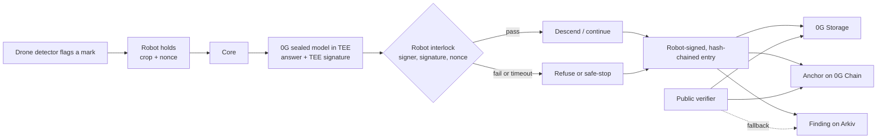

# Blackbox: 0G decides. Blackbox proves it.

A verifiable decision recorder for autonomous inspection robots. Track: **Physical AI: Agents with a Body (0G)**.

## Problem

AI inspection robots now make calls that move money and risk: *this solar cell is cracked*, *that mark is just dirt*, *this bridge deck needs an engineer*. How those calls are recorded is broken in two ways:

1. **The record can't be verified.** It lives in the operator's database, and the operator has the most reason to edit it. The owner, insurer and manufacturer have to take it on trust. Even a signed log can't show which model made the call, whether the answer was produced for this checkpoint, or whether the robot acted only on that answer.
2. **The record can't be queried.** Even an honest record is a pile of files keyed by hashes. People ask about assets: *what is module r2m13's history?* or *do cracks cluster in one maker's batch?*

## What Blackbox is

Blackbox is a recorder SDK for inspection robots. At each checkpoint the robot stops and sends its camera crop to **0G's sealed vision model**, which runs inside a TEE. It moves **only** on an answer signed by an allowlisted 0G TEE signer that echoes the robot's own nonce. Each decision is signed by the robot, hash-chained, stored on **0G Storage** and anchored on **0G Chain**, and each finding is published to **Arkiv** so it can be queried. If 0G can't be reached, the robot stops safely. It never guesses.

The demo flies a Skydio X2 quadrotor in MuJoCo over a **solar farm** and a **bridge deck**, shown in a 3D operator console.

## Features

- **Signed decisions only.** The robot refuses forged or tampered answers: wrong signer, a signature that doesn't cover the answer, or a missing nonce.
- **Tamper-evident log.** Entries are robot-signed and chained with keccak256. The verifier names any entry that was changed.
- **Safe stop.** A lease watchdog sends the drone home when no valid answer arrives and logs *"0G unreachable, no decision made"*. A stopped mission can resume and keep one chain of custody.
- **Deterministic replay.** Re-running a mission from its seed gives the same trajectory hash. A split-screen replay with 0G forced to "continue" shows that 0G's answer is what moved the robot.
- **Public verifier.** It runs in the browser or as a CLI and reads 0G Chain and 0G Storage directly. Scan a QR code to check a mission on your phone.
- **Human in the loop.** When 0G is unsure, the drone holds and the crew answers by text or voice. The sealed model maps their words to an allowed action.
- **Private crops.** Camera crops are encrypted on 0G Storage. The mission key opens them.
- **Mission profiles.** A new inspection task is a JSON file in `scenarios/` plus a `Robot` class.

## How 0G is used

| 0G component | Use |
|---|---|
| **0G Compute (Router)** | `0gm-1.0-35b-a3b`, 0G's sealed vision model (TeeML on Intel TDX), labels each crop and chooses `descend` or `continue`. Requests are sent in private trust mode with `verify_tee`. Decision models (`laya`, `vela-2.0-9b`) return a calibrated confidence, and below a set threshold the robot asks a human. |
| **TEE signature** | Fetched from the provider broker (EIP-191 over `sha256(req):sha256(resp)`). The signer is checked against the `InferenceServing` contract on 0G mainnet. |
| **0G Storage** | Stores the mission manifest, every log entry, every crop and an index per anchor. |
| **0G Chain (Galileo)** | `BlackboxRegistry` calls `registerMission`, then `anchor` every 2 decisions, then `closeMission(trajectoryHash)`. |
| **zerobot** | `RobotRegistry` gives the robot its identity. The robot key must be a registered operator to anchor. |

## How and why Arkiv is used

**Why:** 0G Storage returns a file by its root and nothing else. The proof is permanent but can't be searched. Arkiv makes every finding queryable by asset, label, severity, mission, and the panel's maker, model and batch. Each entity is owned by the wallet that wrote it and expires after the working period (90 days). The proof on 0G never expires.

**How:** Blackbox writes four entity types to the Arkiv Rabdi testnet:

| Entity | Written by | Purpose |
|---|---|---|
| `blackbox.finding` | Inspector, one per decision | Per-asset history and cross-mission analytics |
| `blackbox.asset` | Site owner's wallet | Asset register: maker, model, batch, warranty |
| `blackbox.blob` | Inspector, one per 0G upload | Mirror of every 0G Storage blob, keyed by its root |
| `blackbox.mission` | Inspector | Fleet board |

**Arkiv is never trusted for the verdict.** If 0G Storage is down, the verifier reads blobs from the Arkiv mirror and checks every hash against the anchors on 0G Chain. In our benchmark Arkiv was much faster than 0G Storage on the same entries: batch writes took 7 s vs 76 s, and reads took 0.36 s vs 2.8 s.

## Tech stack

- **Robot:** Python, MuJoCo (Skydio X2 from MuJoCo Menagerie), optional PyBullet, eth-account, pycryptodome. An optional Raspberry Pi rover is also supported.
- **Core:** TypeScript on Node 20, ethers, viem, 0G Storage SDK, 0G Compute SDK, Arkiv SDK.
- **Contracts:** Solidity with Foundry.
- **Console:** React 19, Tailwind CSS 4, three.js, Vite.
- **Networks:** 0G Galileo testnet (16602), 0G mainnet (16661), Arkiv Rabdi testnet (7794095).

## Architecture flow

The core relays the exact response bytes from 0G, and the robot checks the TEE signature itself. A dishonest core can't pair a real signature with a different answer, and it can't sign an answer of its own.

## Future scope

- Deploy `BlackboxRegistry` on 0G mainnet, and move to Arkiv mainnet with the same schema.
- **Repair loop:** crews log a `blackbox.repair` entity, the next inspection confirms or rejects it, and *"is it fixed?"* becomes a query.
- **Insurer view:** defect rates per maker and batch across sites.
- Extend open defects on Arkiv so unresolved findings never expire.
- New verticals such as pipelines, power lines and warehouses, each a new mission profile and `Robot` class.
- Let verified records trigger payments, warranty claims and repair tickets without anyone vouching for the operator.

## Deployment addresses

| Contract | Network | Address |
|---|---|---|
| `BlackboxRegistry` | 0G Galileo (16602) | [`0x8d2793615Cb9953c451eecc065a23FfAaBA777a3`](https://chainscan-galileo.0g.ai/address/0x8d2793615Cb9953c451eecc065a23FfAaBA777a3) |
| zerobot `RobotRegistry` (read) | 0G Galileo (16602) | [`0x291162e93D7A80Eb8F738882a28a7a8A5FBA73bb`](https://chainscan-galileo.0g.ai/address/0x291162e93D7A80Eb8F738882a28a7a8A5FBA73bb) |
| 0G Compute `InferenceServing` (read) | 0G mainnet (16661) | [`0x47340d900bdFec2BD393c626E12ea0656F938d84`](https://chainscan.0g.ai/address/0x47340d900bdFec2BD393c626E12ea0656F938d84) |
| `BlackboxRegistry` | 0G mainnet (16661) | `TODO after the hackathon` |
| Arkiv (Rabdi testnet, 7794095) | entities `blackbox.finding/asset/blob/mission` | writers `0xe0a865190ef3e4a4fD2850D5A879B5C224873286` (inspector), `0x6DD5505E1FcC2CBA5aA57D7Ae60881B12643128C` (site owner) |
