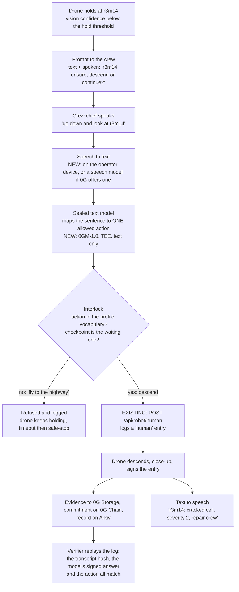
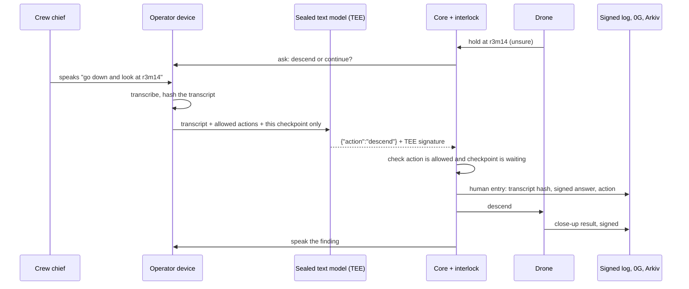

# Voice use case: the crew answers the drone by speaking (flow diagram, DRAFT)

Status: **proposal, not built.** Nothing here needs a demo; it is a flow diagram for the pitch. What already exists is marked.

## The scenario

A drone is surveying a solar farm. The vision model cannot tell a crack from dirt on module r3m14 (confidence below the hold threshold). The drone holds and asks a human. Today that is a button on the console. In the voice version, the crew chief on the ground says:

> "Drone, go down and look at r3m14."

The drone descends, and later reads out the finding to the crew. The operator never touches a screen with gloves on in the sun.

## What already exists (verified in the code)

- `robot/blackbox_robot/adapter.py:388` puts a checkpoint into `await_human` when the calibrated confidence is under `hold_below_permille`, with a `human_timeout_ms` deadline (default 60 s). On timeout the drone safe-stops.
- `POST /api/robot/human` (`core/src/server.ts:127`) takes the human's action; `adapter.py:402` checks it is the waiting checkpoint, then logs a `human` entry with the action and continues.
- The interlock only lets the robot do actions in the profile's vocabulary (`descend`, `continue`).

So voice is a new **front end** to an existing, already-logged path. It does not give the model new powers.

## Flow

## Who is trusted with what

## Why this is more than a chat box

1. **The model cannot widen what the drone may do.** It can only choose from the profile's actions for the checkpoint that is waiting. A command like "fly to the highway" is refused by the interlock, not by the model's good manners.
2. **The command is evidence.** The transcript hash and the sealed model's signed answer go into the same hash-chained log as the vision decision, so a dispute ("who told it to descend?") is answerable by anyone with the log.
3. **The silent default is safe.** No answer within the timeout, or a refused answer, means safe-stop. That path already exists.

## Honest gaps

- Speech-to-text and text-to-speech are not in the repo. I did not find a speech model on the 0G Router pages I read; the simplest claim is that transcription happens on the operator's device and only the **transcript hash** is logged. If the transcript itself is private, say so.
- `0gm-1.0-35b-a3b` is sealed (PrivateTEE, `verify_tee`) but its page lists no image input, which is fine here because this step is text only. That makes the split clean: **vision on Qwen2.5-VL, command parsing on sealed 0GM-1.0.**
- Logging a transcript hash plus the model's output needs a small new field on the `human` entry. Not done.
- Voice adds a failure mode: mis-hearing. The interlock bounds the damage (descend or continue only), but say that out loud rather than implying speech is perfect.

## A text-only version (cheapest to explain)

Same diagram with the microphone removed: the crew types "r3m14 looks like a cracked cell, send it to repair" and the sealed text model maps it to `descend`. This is the better first slide if time is short; voice is the same thing with an extra box at each end.
